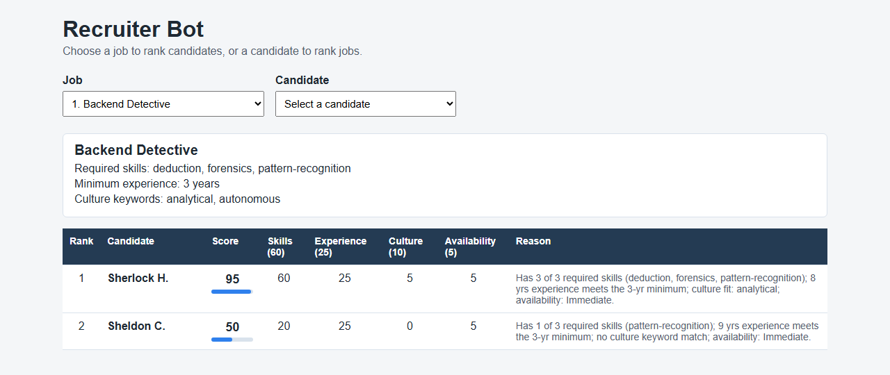
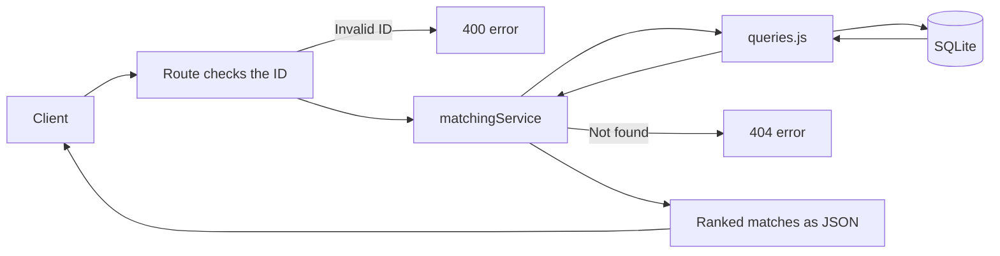
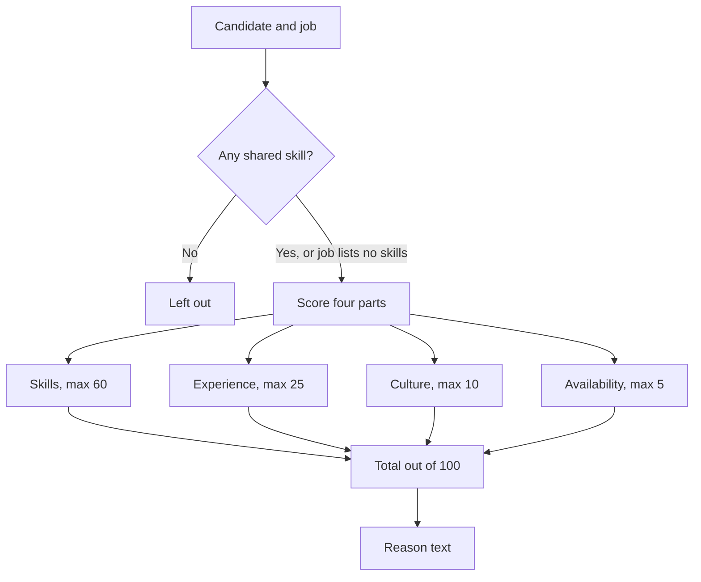
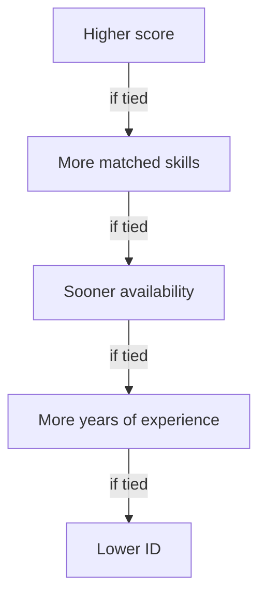
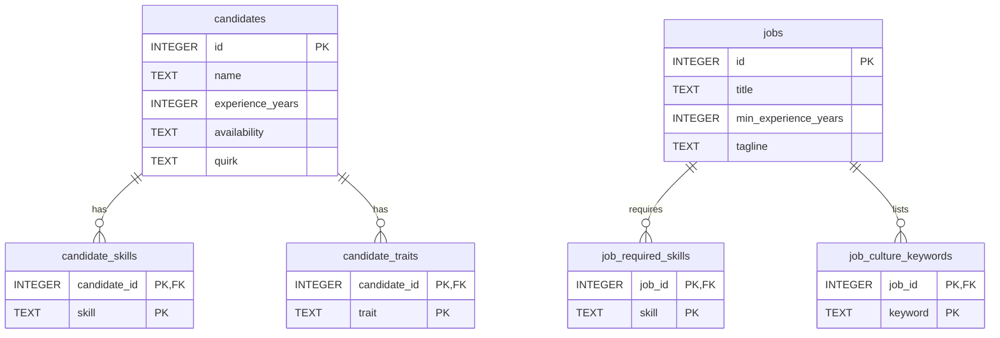

# Recruiter Bot

An Express API that matches candidates to jobs with an explainable score, plus the SQL Detective answers.



**Contents:** [Quick start](#quick-start) · [API](#api) · [How it works](#how-it-works) · [Matching algorithm](#matching-algorithm) · [Trade-offs](#trade-offs) · [What if](#what-if) · [Testing](#testing) · [SQL Detective](#sql-detective-challenge) · [Database design notes](#database-design-notes) · [AI usage](#ai-usage) · [Known limitations](#known-limitations)

## What this is

My solution to the Recruiterflow Backend Developer Intern assignment.

- **Part 1** is an API that ranks candidates for a job, and jobs for a candidate. Each match gets a score out of 100 and a plain-English reason.
- **Part 2** is [`sql_detective.sql`](sql_detective.sql), with one query per SQL Detective question.

**Stack:** Node.js, Express, and SQLite through `better-sqlite3`.

## Quick start

You only need **Node.js 20 or newer**. There is no database server to install, because SQLite keeps everything in one local file.

Clone this repository and open a terminal in the project folder. Then:

1. Install the dependencies with `npm install`.
2. Start the server with `npm start`. You should see `Recruiter Bot API running at http://localhost:3000`. On startup, the server creates the database and loads the 15 candidates and 6 jobs from the brief.
3. Open **http://localhost:3000** in a browser. Pick a job or a candidate to see the ranked matches in a table, with each score's breakdown and reason.
4. In a second terminal, run the automated tests with `npm test`.
5. See the Part 2 answers with `npm run sql:detective`. This prints the result of each SQL Detective query as a table.

> [!TIP]
> Try **Backend Detective** first on the demo page. Sherlock H. ranks first with a score of 95.

Other commands:

```bash
npm test               # run the automated tests
npm run dev            # start the server and restart it when a file changes
npm run db:reset       # delete the database and rebuild it from scratch
npm run db:init        # create and seed the database without starting the server
```

## API

| Endpoint | Returns |
| --- | --- |
| `GET /jobs/:id/matches` | Candidates ranked best to worst for a job |
| `GET /candidates/:id/matches` | Jobs ranked best to worst for a candidate |
| `GET /jobs` | All jobs, to look up IDs |
| `GET /candidates` | All candidates, to look up IDs |

Job IDs are 1 to 6 and candidate IDs are 1 to 15, in the order they appear in the brief.

```bash
curl http://localhost:3000/jobs/1/matches
```

Each match has a rank, a score out of 100, a short reason, and a breakdown of the points:

```json
{
  "rank": 1,
  "candidateId": 1,
  "candidateName": "Sherlock H.",
  "score": 95,
  "reason": "Has 3 of 3 required skills (deduction, forensics, pattern-recognition); 8 yrs experience meets the 3-yr minimum; culture fit: analytical; availability: Immediate.",
  "details": {
    "skills": { "matched": ["deduction", "forensics", "pattern-recognition"], "missing": [], "points": 60 },
    "experience": { "candidateYears": 8, "requiredYears": 3, "meetsMinimum": true, "points": 25 },
    "culture": { "matched": ["analytical"], "points": 5 },
    "availability": { "status": "Immediate", "points": 5 }
  }
}
```

The `details` object above is shortened. The real response has a few more fields.

**Errors** return JSON like `{ "error": "Job with ID 999 not found." }`:

| Status | When |
| --- | --- |
| 400 | The ID is not a positive whole number, such as `abc` |
| 404 | No job or candidate has that ID |
| 500 | An unexpected server error |

A candidate who shares no skills with any job still gets a 200 response, with an empty `matches` list.

## How it works

This shows what happens to a request, from the client to the database and back.



This shows how one candidate and one job become a score.



This shows the order used to rank matches. Each step only matters if the steps above it are tied.



This shows the six database tables and how they link together.



## Matching algorithm

Each candidate and job pair gets a score out of 100:

| Part | Points | Rule |
| --- | --- | --- |
| Skills | 60 | Share of the job's required skills the candidate has |
| Experience | 25 | Full points if they meet the minimum, otherwise partial |
| Culture fit | 10 | Share of the job's culture keywords that match a candidate trait |
| Availability | 5 | Immediate 5, 2 weeks 3, Not looking 0 |

**Example:** Sherlock for Backend Detective scores 60 + 25 + 5 + 5 = **95**.

- He has all 3 required skills, for 60.
- His 8 years beat the 3-year minimum, for 25.
- One of the two culture keywords matches his trait "analytical", for 5.
- He is available immediately, for 5.

**Why these choices:**

- **Skills weigh most.** They are the strongest sign that someone can do this specific job.
- **Experience stops at the minimum.** Twenty years is not a better fit than eight for a job asking for three. A bonus for extra years would let senior candidates outrank better skill matches.
- **Culture and availability are small nudges.** A one-word trait is a weak signal, and availability should not hide a strong candidate.
- **Zero-skill candidates are left out.** Experience, culture and availability alone should not make someone a match.
- **Ties:** if two candidates are equally good, the one who can start sooner ranks higher. After that come more years of experience, then lower ID, so the order is always the same.
- **Empty lists give full points.** A job with no required skills or no culture keywords gives full points for that part. This also avoids dividing by zero.

All the scoring lives in one file, `src/services/matchingService.js`. Both endpoints use the same scoring function, so a pair always gets the same score from either side.

## Trade-offs

- **All skills count equally.** A job cannot mark one skill as more important.
- **Matching is exact.** "persuasion" does not count as "sales".
- **Scores are calculated on each request instead of stored.** This is instant for this data size, and a score can never go out of date.
- **The weights are my own judgement**, not a tuned model.

## What if

| Question | How I'd handle it |
| --- | --- |
| Some skills matter more than others? | Add a weight column to `job_required_skills` and multiply each matched skill by its weight. |
| Synonyms, like "persuasion" and "sales"? | Add a `skill_aliases` table that maps each variant to one standard skill before matching. |
| 100,000 candidates? | Load data in a fixed number of queries, which is already done. Pre-filter in SQL to candidates sharing at least one skill. Store scores in a match table that is refreshed when data changes. Index the skill columns. |
| Changing the weights? | They live in one `WEIGHTS` object, so it is a one-line change. |

## Testing

`npm test` runs 8 tests with Node's built-in test runner. No extra packages are needed.

1. Job 1 returns 200, and Sherlock H. is first with 95.
2. For every job, scores never go up and ranks run 1, 2, 3 with no gaps.
3. Both endpoints give the same score for the same candidate and job.
4. No match has zero matched skills. Job 1 returns only Sherlock H. and Sheldon C.
5. Tie-break: for job 2, Rick S. ranks above Tony S. Both score 90, but Rick is available immediately.
6. Invalid IDs give 400 and unknown IDs give 404, each with an error message.
7. A job with no required skills or keywords gives a valid score, with no divide-by-zero.
8. A candidate who shares no skill with any job gets 200 with an empty list. No seed candidate does this, so the test adds a temporary one and removes it afterwards.

### Testing with Postman

No Postman account is needed. Postman's free lightweight API client works without signing in.

1. Start the server with `npm start`.
2. Open Postman and continue without signing in.
3. Open a new GET request, paste a URL from the table, and click **Send**.
4. Check the status code and the JSON response.

| URL | Expected |
| --- | --- |
| `http://localhost:3000/jobs/1/matches` | 200. Only Sherlock H. (95) and Sheldon C. are returned |
| `http://localhost:3000/candidates/1/matches` | 200. Backend Detective ranks first with 95 |
| `http://localhost:3000/jobs/abc/matches` | 400. Invalid ID |
| `http://localhost:3000/jobs/999/matches` | 404. Job not found |
| `http://localhost:3000/candidates/abc/matches` | 400. Invalid ID |
| `http://localhost:3000/candidates/999/matches` | 404. Candidate not found |

If you have a Postman account, you can import these requests from `postman/Recruiterflow.postman_collection.json` instead.

## SQL Detective Challenge

`sql_detective.sql` creates the four tables, loads the supplied data, and runs one query per question:

```bash
npm run sql:detective
```

It also works with the sqlite3 command-line tool or any SQLite GUI.

| Question | Answer |
| --- | --- |
| Q1. Open postings with recruiter | Postings 1, 2, 4 and 5 |
| Q2. Applicants who reached Final, per posting | 2, 2, 1, 2, 0, 0, 2 for postings 1 to 7 |
| Q3. People who applied to more than one posting | Ananya Rao (postings 1, 4), Ben Turner (1, 3), Elena Popescu (2, 7) |
| Q4. Final-stage conversion rate | Priya Shah 75%, Daniel Ortiz 50% |
| Q5. Top recruiter per department | Data: Fatima Al-Sayed (1). Engineering: Priya Shah (3) |

**Assumptions:**

- **Q2:** postings with no Final interviews are still listed, with a count of 0. People are counted by email, the same rule as Q3, so one person is never counted twice.
- **Q3:** two applicant records are the same person if their emails match, ignoring capital letters. Applicants 1 and 2 are both Ananya Rao with differently capitalised emails, so they are treated as one person. Since there is no applications table, an interview for a posting counts as applying to it.
- **Q4:** the conversion rate is shown as a percentage.
- **Q5:** `RANK()` is used so that tied recruiters are all returned. Departments with no placements are not listed.

## Database design notes

- Skills, traits and keywords are stored one per row instead of as comma-separated text. This makes them easy to compare and query.
- The child tables use foreign keys to link back to their candidate or job.
- SQLite does not enforce foreign keys unless you turn them on, so the app runs `PRAGMA foreign_keys = ON` when it connects.
- Matches are not stored in a table. They are calculated when requested.

> [!NOTE]
> The database file in `data/` is not committed. The app creates it on the first run from `src/db/schema.sql` and `src/db/seed.js`.

## AI usage

I used Claude as a coding assistant for the implementation, the tests and this README. The automated tests in `tests/api.test.js` were written with Claude's help. I reviewed the code, chose the matching rules and trade-offs, and checked the SQL Detective answers against the data. I tested the project with `npm test`, `npm run sql:detective` and Postman.

## Known limitations

- The API is read-only. Data comes from the seed script.
- After editing the seed data, run `npm run db:reset` to apply the changes.
